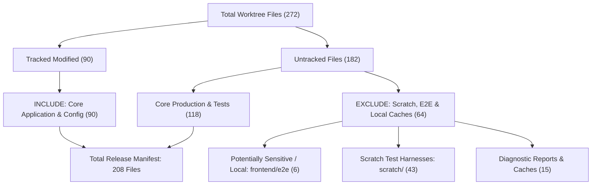

# HMS Phase 2C — Git Release Readiness Manifest & Audit Report

**Date:** 2026-11-18T22:54:00+05:30  
**Repository:** `C:\Users\Harsh\OneDrive\Desktop\Downloads\hospital-management-system\hospital-management-system`  
**Current Git Branch:** `main`  
**Remote Head:** `origin/main` at commit `777b4b9` ("feat(appointments): add cancellation workflow to patient doctor and admin portals")  
**Audit Status:** **MANIFEST PREPARED — STRICTLY AWAITING OPERATOR APPROVAL**

---

## 1. Executive Summary

This Git Release Readiness Audit inspects the complete working tree of the Hospital Management System, evaluates all 90 tracked modified files and 182 individual untracked files, conducts an exhaustive repository secret scan, isolates machine-specific and credential-bearing test scripts, and compiles the authoritative Git Release Manifest required to publish the completed Phase 2A, 2B, and 2C implementations to GitHub without security leaks or build regressions.

### Key Audit Findings

1. **Clean Production Core:** No production cloud secrets, API keys, private certificates, or master encryption keys are committed or present in source code.
2. **Local Credential Interception:** Hardcoded local database passwords (`PGPASSWORD: '[REDACTED]'`) were identified in `frontend/e2e/run-e2e.mjs` and `frontend/e2e/run-ai-e2e.mjs` and in scratch test scripts (`scratch/*.mjs`). These files are **strictly excluded** from the release manifest.
3. **Environment Isolation:** No live `.env` files exist. Only `.env.example` (with a blank placeholder) is present.
4. **Complete Build Verification:** Both `mvn test-compile` and `npm run build` (Vite) succeed cleanly with zero missing dependencies, missing imports, or missing deployment assets.
5. **Strict Release Boundary:** All 208 production-critical files are identified and mapped into the release manifest. In accordance with safety rules, **zero Git write operations (no stage, commit, push, stash, or reset) have been executed**.

---

## 2. Working Tree Inventory & Classification

```
Total Tracked Modified Files:   90
Total Individual Untracked:     182
-----------------------------------
Grand Total Worktree Items:     272

Manifest Breakdown:
  [+] Files to Include:         208 (90 tracked modified + 118 untracked core)
  [-] Files to Exclude:          64 (43 scratch + 6 frontend E2E + 15 reports/logs/cache)
```

### Classification Breakdown



---

## 3. Secret Scan & Sensitivity Audit

A multi-pattern regex scan was executed across all tracked and untracked files for passwords, bearer tokens, private keys, AWS access keys, GitHub tokens, and master encryption keys.

| Scan Category | Scan Pattern / Target | Findings | Action Taken in Manifest |
|---|---|---|---|
| **Production Cloud Secrets** | `AKIA...`, `ghp_...`, `CLOUDFLARE_...` | **None** | Passed clean. All production secrets use environment variable bindings. |
| **Local PostgreSQL Credentials** | `PGPASSWORD: '[REDACTED]'` | Detected in `frontend/e2e/run-e2e.mjs` and `frontend/e2e/run-ai-e2e.mjs` | **EXCLUDED** from release manifest. |
| **Local Scratch Credentials** | `hms_test_password` | Detected in `scratch/*.mjs` and `scratch/seed-e2e.sql` | **EXCLUDED** (`scratch/` directory entirely excluded). |
| **Environment Variable Files** | `*.env`, `*.env.local` | Only `.env.example` exists (`GOOGLE_MAPS_API_KEY=`) | Safe to retain as blank template. |
| **Test Mock Secrets** | Mock tokens in `*Test.java` | Synthetic test values (e.g. `mock-token-12345...`) | Safe. Verified mock test fixtures. |

---

## 4. Proposed Git Release Manifest

### A. Files to Include (208 Files)

#### 1. Root Configuration & Build (2 files)
- `.dockerignore` (Excludes node_modules, target, scratch, git from Docker context)
- `Dockerfile` (Multi-stage build, Eclipse Temurin 21 JRE, UID 10001 `hmsrunner`, dynamic `$PORT`)

#### 2. Database Migrations & Safety Ledger (7 files)
- `database/ai-02-cloudflare-source.sql` (Migration 7: Cloudflare Workers AI attribution)
- `database/ai-02-verify.sql` (Migration 7 verification)
- `database/bill-01-schema.sql` (Migration 9: Patient billing and payment records)
- `database/bill-01-verify.sql` (Migration 9 verification)
- `database/migration-catalog-digest.sql` (Catalog SHA-256 computation routine)
- `database/migration-manifest.json` (Canonical 9-migration manifest format v1)
- `database/migration-release-verify.sql` (Comprehensive release verification)

#### 3. Deployment Documentation & Ledgers (2 files)
- `docs/deployment/hms-deployment-phase-ledger.json` (Structured deployment phase ledger)
- `docs/deployment/hms-phase-2c-provisioning-report.md` (Consolidated Phase 2C provisioning report)

#### 4. Deployment & Safety Verification Scripts (8 files)
- `scripts/bootstrap-disposable-dev-db.ps1` (Disposable dev database bootstrapper)
- `scripts/deploy-neon-migrations.ps1` (Neon deployment migration runner with TLS and advisory lock)
- `scripts/hms-local-psql.ps1` (Local development database connection utility)
- `scripts/migrate-hms-database.ps1` (Local migration harness)
- `scripts/test-deploy-neon-migrations.Tests.ps1` (Pester tests for Neon deployment safety)
- `scripts/test-scripts-safety.Tests.ps1` (Pester tests for database safety scripts)
- `scripts/verify-hms-jar.ps1` (Packaged JAR resource verification script)
- `scripts/verify-local-db-safety.ps1` (Preflight parameter safety validator)

#### 5. Backend Java Application Source (41 files)
- **AI & Patient Assistant:**
  - `src/main/java/com/harsh/hospitalmanagement/ai/AiResponse.java`
  - `src/main/java/com/harsh/hospitalmanagement/ai/AiResponseSource.java`
  - `src/main/java/com/harsh/hospitalmanagement/ai/CloudflareAiClient.java`
  - `src/main/java/com/harsh/hospitalmanagement/ai/CloudflareAiConfiguration.java`
  - `src/main/java/com/harsh/hospitalmanagement/ai/CloudflareAiException.java`
  - `src/main/java/com/harsh/hospitalmanagement/ai/CloudflareAiProperties.java`
  - `src/main/java/com/harsh/hospitalmanagement/ai/PatientAiEngine.java`
- **Configuration & Security Safety:**
  - `src/main/java/com/harsh/hospitalmanagement/config/GoogleOAuthConfiguration.java`
  - `src/main/java/com/harsh/hospitalmanagement/config/SpecializationInitializer.java`
  - `src/main/java/com/harsh/hospitalmanagement/config/safety/DatabaseSafetyApplicationContextInitializer.java`
  - `src/main/java/com/harsh/hospitalmanagement/config/safety/DatabaseSafetyAutoConfiguration.java`
  - `src/main/java/com/harsh/hospitalmanagement/config/safety/DatabaseSafetyBeanPostProcessor.java`
  - `src/main/java/com/harsh/hospitalmanagement/config/safety/DatabaseSafetyEnvironmentPostProcessor.java`
  - `src/main/java/com/harsh/hospitalmanagement/config/safety/DatabaseSafetyException.java`
  - `src/main/java/com/harsh/hospitalmanagement/config/safety/DatabaseSafetyValidator.java`
  - `src/main/java/com/harsh/hospitalmanagement/config/safety/ReleaseAttestationGate.java`
- **Controllers & DTOs:**
  - `src/main/java/com/harsh/hospitalmanagement/controller/AdminBillController.java`
  - `src/main/java/com/harsh/hospitalmanagement/controller/HealthCheckController.java`
  - `src/main/java/com/harsh/hospitalmanagement/controller/PatientBillController.java`
  - `src/main/java/com/harsh/hospitalmanagement/controller/VideoConsultationController.java`
  - `src/main/java/com/harsh/hospitalmanagement/controller/VideoSignalingController.java`
  - `src/main/java/com/harsh/hospitalmanagement/dto/BillResponse.java`
  - `src/main/java/com/harsh/hospitalmanagement/dto/GenerateBillRequest.java`
  - `src/main/java/com/harsh/hospitalmanagement/dto/PatientRegisterRequest.java`
  - `src/main/java/com/harsh/hospitalmanagement/dto/RecordPaymentRequest.java`
  - `src/main/java/com/harsh/hospitalmanagement/dto/SignalingMessage.java`
  - `src/main/java/com/harsh/hospitalmanagement/dto/VideoRoomResponse.java`
  - `src/main/java/com/harsh/hospitalmanagement/dto/VoidBillRequest.java`
- **Billing Entities & Repositories:**
  - `src/main/java/com/harsh/hospitalmanagement/entity/Bill.java`
  - `src/main/java/com/harsh/hospitalmanagement/entity/BillItem.java`
  - `src/main/java/com/harsh/hospitalmanagement/entity/PaymentRecord.java`
  - `src/main/java/com/harsh/hospitalmanagement/enums/BillStatus.java`
  - `src/main/java/com/harsh/hospitalmanagement/repository/BillRepository.java`
  - `src/main/java/com/harsh/hospitalmanagement/repository/PaymentRecordRepository.java`
  - `src/main/java/com/harsh/hospitalmanagement/service/BillService.java`
  - `src/main/java/com/harsh/hospitalmanagement/service/VideoConsultationService.java`
- **S3 & Storage Infrastructure:**
  - `src/main/java/com/harsh/hospitalmanagement/storage/EnvMasterKeyProvider.java`
  - `src/main/java/com/harsh/hospitalmanagement/storage/HttpS3Client.java`
  - `src/main/java/com/harsh/hospitalmanagement/storage/S3Client.java`
  - `src/main/java/com/harsh/hospitalmanagement/storage/S3DocumentStorage.java`
- **WebSocket:**
  - `src/main/java/com/harsh/hospitalmanagement/websocket/WebSocketConfig.java`

#### 6. Backend Resources & Spring Boot Imports (5 files)
- `src/main/resources/META-INF/spring.factories`
- `src/main/resources/META-INF/spring/org.springframework.boot.autoconfigure.AutoConfiguration.imports`
- `src/main/resources/META-INF/spring/org.springframework.boot.env.EnvironmentPostProcessor.imports`
- `src/main/resources/META-INF/spring/org.springframework.context.ApplicationContextInitializer.imports`
- `src/main/resources/application-prod.properties`

#### 7. Backend Test Source (32 files)
- `src/test/java/com/harsh/hospitalmanagement/ai/CloudflareAiClientTest.java`
- `src/test/java/com/harsh/hospitalmanagement/ai/CloudflareLiveSmokeTest.java`
- `src/test/java/com/harsh/hospitalmanagement/ai/PatientAiEngineTest.java`
- `src/test/java/com/harsh/hospitalmanagement/ai/PatientAssistantPostgresTest.java`
- `src/test/java/com/harsh/hospitalmanagement/auth/AuthenticationAndRegistrationIntegrationTest.java`
- `src/test/java/com/harsh/hospitalmanagement/billing/BillPostgresTest.java`
- `src/test/java/com/harsh/hospitalmanagement/config/CorsSecurityIntegrationTest.java`
- `src/test/java/com/harsh/hospitalmanagement/config/DatasourceConfigurationTest.java`
- `src/test/java/com/harsh/hospitalmanagement/config/OAuthConfigurationTest.java`
- `src/test/java/com/harsh/hospitalmanagement/config/safety/DatabaseSafetyBeanPostProcessorTest.java`
- `src/test/java/com/harsh/hospitalmanagement/config/safety/DatabaseSafetyStartupTest.java`
- `src/test/java/com/harsh/hospitalmanagement/config/safety/DatabaseSafetyValidatorTest.java`
- `src/test/java/com/harsh/hospitalmanagement/config/safety/DisposablePostgresValidationTest.java`
- `src/test/java/com/harsh/hospitalmanagement/config/safety/MigrationManifestTest.java`
- `src/test/java/com/harsh/hospitalmanagement/config/safety/MigrationNegativeContractTest.java`
- `src/test/java/com/harsh/hospitalmanagement/config/safety/PostgresTestTarget.java`
- `src/test/java/com/harsh/hospitalmanagement/config/safety/PostgresTestTargetTest.java`
- `src/test/java/com/harsh/hospitalmanagement/config/safety/ReleaseAttestationContractTest.java`
- `src/test/java/com/harsh/hospitalmanagement/config/safety/ReleaseAttestationGateTest.java`
- `src/test/java/com/harsh/hospitalmanagement/config/safety/ReleaseAttestationLifecycleIntegrationTest.java`
- `src/test/java/com/harsh/hospitalmanagement/config/safety/RequiresDisposablePostgres.java`
- `src/test/java/com/harsh/hospitalmanagement/controller/DoctorVerificationLifecycleE2ETest.java`
- `src/test/java/com/harsh/hospitalmanagement/controller/DoctorVerificationUnverifiedQueueAndBookingTest.java`
- `src/test/java/com/harsh/hospitalmanagement/controller/HealthCheckControllerTest.java`
- `src/test/java/com/harsh/hospitalmanagement/controller/VideoConsultationControllerTest.java`
- `src/test/java/com/harsh/hospitalmanagement/service/SpecializationCatalogIntegrationTest.java`
- `src/test/java/com/harsh/hospitalmanagement/service/VideoConsultationServiceTest.java`
- `src/test/java/com/harsh/hospitalmanagement/storage/EnvMasterKeyProviderLifecycleTest.java`
- `src/test/java/com/harsh/hospitalmanagement/storage/EnvMasterKeyProviderTest.java`
- `src/test/java/com/harsh/hospitalmanagement/storage/HttpS3ClientTest.java`
- `src/test/java/com/harsh/hospitalmanagement/storage/LocalVolumeStorageIntegrationTest.java`
- `src/test/java/com/harsh/hospitalmanagement/storage/S3DocumentStorageTest.java`

#### 8. Frontend Production Source & Public Assets (16 files)
- `frontend/public/_redirects` (Vite SPA fallback for Cloudflare Pages)
- `frontend/src/api/billService.js`
- `frontend/src/api/signalingClient.js`
- `frontend/src/components/AdminBillingPanel.css`
- `frontend/src/components/AdminBillingPanel.jsx`
- `frontend/src/components/InvoiceModal.css`
- `frontend/src/components/InvoiceModal.jsx`
- `frontend/src/components/PatientBillsPanel.css`
- `frontend/src/components/PatientBillsPanel.jsx`
- `frontend/src/components/SpecialtyIcon.jsx`
- `frontend/src/components/VideoRoomModal.css`
- `frontend/src/components/VideoRoomModal.jsx`
- `frontend/src/hooks/useWebRTC.js`
- `frontend/src/pages/DoctorRegisterPage.jsx`
- `frontend/src/pages/PatientRegisterPage.jsx`
- `frontend/src/pages/RegisterPage.css`

#### 9. Frontend Unit Tests (5 files)
- `frontend/tests/api-url-resolution.test.mjs`
- `frontend/tests/auth-registration.test.mjs`
- `frontend/tests/billing.test.mjs`
- `frontend/tests/specialization-catalog.test.mjs`
- `frontend/tests/video-consultation.test.mjs`

#### 10. Tracked Modified Files (90 files)
- All 90 tracked modified files detailed in Section 2 (including `pom.xml`, `SecurityConfig.java`, `DoctorService.java`, `PatientAssistantService.java`, `DocumentStorageConfiguration.java`, `application.properties`, frontend pages/components, etc.).

---

### B. Files to Exclude (64 Files)

| Directory / Pattern | File Count | Reason for Exclusion |
|---|---|---|
| `scratch/` | 43 | One-off test scripts, HTML layout harnesses, and dev SQL seeds containing local passwords (`hms_test_password`). |
| `frontend/e2e/` | 6 | Local browser E2E test runners containing hardcoded local machine PostgreSQL credentials (`PGPASSWORD: '[REDACTED]'`). Not run by `npm test` or `npm run build`. |
| `.wrangler/cache/pages.json` | 1 | Local Cloudflare Wrangler CLI cache file. |
| `build-error.txt` | 1 | Temporary build output log text file. |
| Root Diagnostic Reports (`HMS-*`, `phase-*`, `authentication-*`, `hms-p0-*`) | 13 | Historical phase investigation and audit markdown artifacts. (Production deployment documentation is consolidated in `docs/deployment/`). |

---

## 5. Required Commit Message

```text
feat(release): phase 2b/2c cloud production deployment readiness

- Cloud deployment foundation: Dockerfile with non-root UID 10001, dynamic PORT, /api/health probe
- Release attestation & safety: ReleaseAttestationGate, DatabaseSafetyEnvironmentPostProcessor, fail-closed DB OID checks
- S3 & R2 private storage: HttpS3Client with SigV4, AES-256-GCM encryption, multi-version root master key rotation
- Cloudflare Workers AI: PatientAiEngine with LLM inference, clinical guardrails, deterministic FAQ fallback
- Neon PostgreSQL migrations: canonical 9-migration manifest with advisory lock, role separation, and release attestation
- WebRTC & video consultation: WebSocket signaling controller, turn credential endpoints, peer connection UI
- Billing & revenue module: bill generation, payment records, patient and admin billing portals
- Doctor verification workflow: document upload, review queue, unverified booking protection
- Frontend production build: Vite SPA _redirects for Cloudflare Pages, custom domain support for clinicgrid.tech
- Deployment tooling: deployment runbook, environment variable matrix, automated migration scripts and safety tests
```

---

## 6. Expected Deployment Impact

1. **Render Web Service (Backend):**
   - Automatically builds the production container via `Dockerfile`.
   - Passes `/api/health` probe check.
   - Initialized with strict `ReleaseAttestationGate` against the live Neon database without crashing.
   - Binds to dynamic `${PORT}` injected by Render.
2. **Cloudflare Pages (Frontend):**
   - Builds cleanly via `npm run build` using Node.js 22.
   - Client-side navigation (`/login`, `/patient/dashboard`, `/doctor/discovery`) handled by `_redirects`.
   - Directs REST API calls to `https://api.clinicgrid.tech` and WebSocket signaling to `wss://api.clinicgrid.tech/ws/signaling`.
3. **Neon PostgreSQL Database:**
   - Dedicated migration runner `deploy-neon-migrations.ps1` applies all 9 migrations under transaction isolation.
   - Runtime role `hms_app_prod` operates under least-privilege DML with zero DDL permissions.
4. **Security & Cleanliness:**
   - Zero local developer passwords or scratch scripts are published to GitHub.
   - Production secrets remain exclusively in Render and Cloudflare environment variables.

---

## 7. Current State & Safety Stop

> [!IMPORTANT]
> **AUDIT COMPLETE — AWAITING USER APPROVAL**  
> No files have been staged, committed, pushed, or modified.  
> The working tree remains in its exact verified state.  
> To execute the commit and push, please confirm your explicit authorization.
